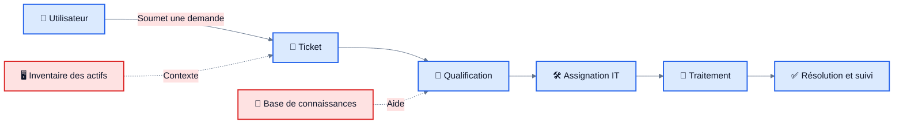
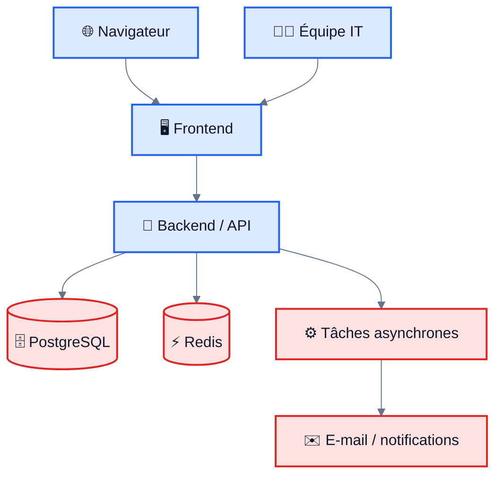

<a id="top"></a>

<div align="center">

# 🧭 appDesk

### Le support IT et la gestion de parc, sans complexité inutile

**Tickets · Inventaire · Base de connaissances · Rapports**  
Une application open source inspirée des outils de helpdesk comme GLPI, pensée pour rester simple à déployer, comprendre et faire évoluer.

[](./LICENSE)
[](https://github.com/teremuhamblin/appDesk/actions/workflows/static.yml)
[](https://github.com/teremuhamblin/appDesk/actions/workflows/publish-test-package.yml)
[](https://github.com/teremuhamblin/appDesk/actions/workflows/pages/pages-build-deployment)
[](https://github.com/teremuhamblin/appDesk)

[**✨ Fonctionnalités**](#fonctionnalites) · [**🧭 Parcours**](#parcours) · [**🚀 Démarrage**](#demarrage) · [**🏗️ Architecture**](#architecture) · [**📚 Documentation**](#documentation) · [**🔐 Sécurité**](#securite) · [**🤝 Contribuer**](#contribuer)

</div>

---

<a id="apropos"></a>
## 👋 À propos

**appDesk** est un logiciel open source de gestion des demandes de support et des actifs informatiques. Il vise à réunir, dans un espace accessible, les échanges entre utilisateurs et équipes IT ainsi que les informations utiles au suivi du parc.

> [!NOTE]
> appDesk s’inspire de la catégorie des solutions de helpdesk et de gestion de parc, dont GLPI. Il s’agit d’un projet indépendant, non affilié à GLPI.

### Pour qui ?

- 🧑‍💻 **Utilisateurs** qui souhaitent créer et suivre une demande.
- 🛠️ **Techniciens** qui qualifient, assignent et résolvent des tickets.
- 🗂️ **Équipes IT** qui veulent centraliser des informations de parc et de documentation.
- 🧰 **Développeurs et administrateurs** qui souhaitent déployer ou étendre le projet.

---

<a id="fonctionnalites"></a>
## ✨ Fonctionnalités

| Domaine | Capacités présentées par le projet |
|:--|:--|
| 🎫 **Tickets** | Création, assignation et suivi des demandes. |
| 🖥️ **Inventaire** | Gestion d’actifs tels que machines, logiciels et contrats. |
| 📖 **Connaissances** | Base de connaissances pour documenter les réponses et procédures. |
| 📊 **Pilotage** | Rapports et statistiques pour suivre l’activité. |
| 🔔 **Notifications** | Notifications par e-mail selon la configuration. |
| 🧩 **Extensibilité** | Organisation modulaire et orientation API pour faciliter les évolutions. |

> Les fonctions disponibles peuvent dépendre de l’état du code et de la configuration. Consulte la documentation et les services réellement activés dans ton environnement.

---

<a id="parcours"></a>
## 🗺️ Parcours d’une demande



---

<a id="architecture"></a>
## 🏗️ Architecture — vue logique

Ce schéma illustre les composants annoncés dans le dépôt. Les versions et détails précis de la stack sont à confirmer dans les fichiers de configuration et la documentation de déploiement.



---

<a id="demarrage"></a>
## 🚀 Démarrage

Le guide de lancement à la racine du dépôt est [`Launch.md`](./Launch.md). Il décrit le parcours de démarrage en environnement **DEV** et les commandes Docker Compose associées.

### Lancer en développement

1. Consulte [`Launch.md`](./Launch.md) et les fichiers Compose pour les prérequis, variables et ports.
2. Depuis le dossier du projet, démarre les services de développement avec la commande documentée dans le guide :

   ```bash
   docker-compose up --build
   ```

3. Pour vérifier ou arrêter les services, suis les étapes et URLs indiquées dans [`Launch.md`](./Launch.md).

> N’expose pas directement une configuration de développement sur Internet. Avant tout déploiement, configure les secrets et paramètres propres à l’environnement, vérifie les ports exposés et suis les consignes de sécurité du projet.

### Vérifications rapides

Les URLs locales, ports et commandes détaillées sont documentés dans [`Launch.md`](./Launch.md). Les valeurs par défaut peuvent varier selon les fichiers Compose et les surcharges locales.

---

<a id="documentation"></a>
## 📚 Documentation et structure

- 🚀 **[Guide de lancement](./Launch.md)** — démarrage DEV/PROD et commandes Compose.
- 📚 **[Index de la documentation](./Docs/README.md)** — architecture, installation, API et guides.
- 🗂️ **[Structure du dépôt](./Docs/structure.md)** — organisation des principaux dossiers.
- 🔌 **[Référence API](./Docs/api_reference.rst)** — endpoints et conventions documentés.
- 🛠️ **[Backend](./Backend/README.md)** — informations de développement backend.
- 📦 **[Docker Compose](./docker-compose.yml)** — services de base déclarés.
- 🧪 **[Docker Compose DEV](./docker-compose.override.yml)** — surcharge locale de développement, si utilisée.

### Structure à haut niveau

```text
appDesk/
├── Backend/       # API et logique serveur
├── Frontend/      # Interface web
├── Docs/          # Documentation projet
├── docker-compose.yml
├── docker-compose.override.yml
├── Launch.md
├── LICENSE
└── README.md
```

Pour le détail, consulte [`Docs/structure.md`](./Docs/structure.md).

---

<a id="securite"></a>
## 🔐 Sécurité et bonnes pratiques

- 🔑 **Secrets :** ne versionne jamais mots de passe, clés API, jetons ou fichiers d’environnement contenant des secrets.
- 🌐 **Déploiement :** utilise HTTPS derrière un reverse proxy adapté et n’expose que les ports nécessaires.
- 🗄️ **Données :** mets en place des sauvegardes et vérifie régulièrement les procédures de restauration de la base.
- 👥 **Accès :** applique le principe du moindre privilège aux comptes et services.
- 🧪 **Mises à jour :** maintiens les images et dépendances à jour après vérification de leur compatibilité.
- 🐛 **Signalement :** consulte la politique [`SECURITY.md`](./SECURITY.md) avant de signaler une vulnérabilité.

> [!WARNING]
> Les badges de workflow indiquent l’état des exécutions GitHub Actions correspondantes ; ils ne constituent pas une certification de sécurité ou de disponibilité du service.

---

<a id="contribuer"></a>
## 🤝 Contribuer

Les améliorations, corrections et suggestions sont les bienvenues. Pour faciliter leur revue :

1. Vérifie les issues et discussions existantes.
2. Décris le problème ou la proposition avec le contexte utile.
3. Garde les changements ciblés et documente les paramètres ajoutés.
4. N’inclus aucun secret ni donnée personnelle dans le code ou les captures.
5. Ouvre une Pull Request avec les étapes de vérification effectuées.

---

<a id="licence"></a>
## 📄 Licence

appDesk est distribué sous licence [**MIT**](./LICENSE).

---

<div align="center">

**appDesk** · Le support IT, les actifs et les connaissances au même endroit  
[⬆️ Retour en haut](#top)

</div>
