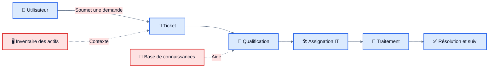
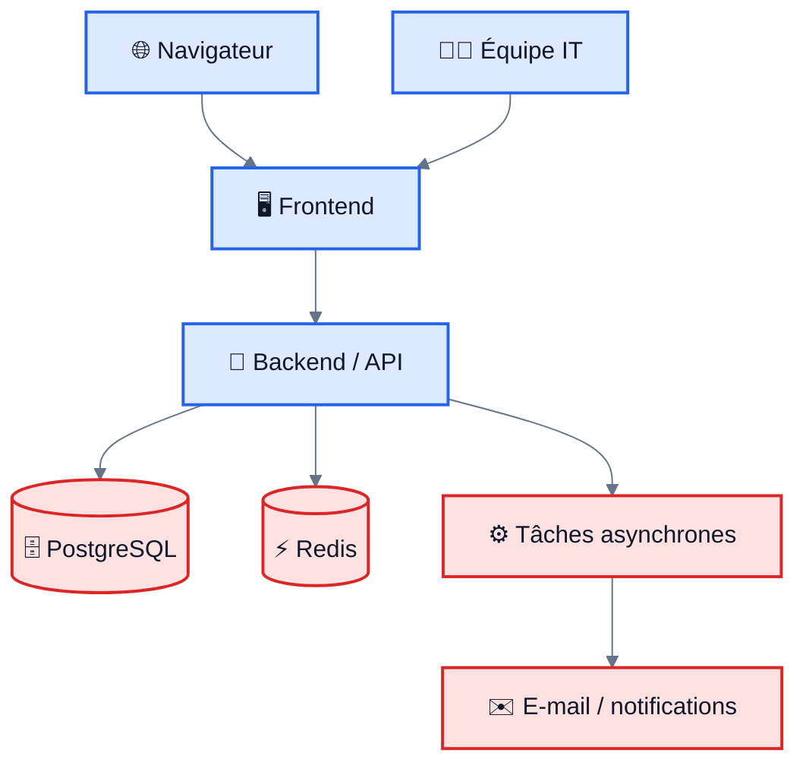

<a id="top"></a>

<div align="center">

# 🧭 appDesk

### Le support IT et la gestion de parc, sans complexité inutile

**Tickets · Inventaire · Base de connaissances · Rapports**  
Une application open source de helpdesk et de gestion de parc, inspirée de la catégorie d’outils comme GLPI, conçue pour être simple à explorer et à faire évoluer.

[](./LICENSE)

---

[](https://github.com/teremuhamblin/appDesk/actions/workflows/static.yml)
[](https://github.com/teremuhamblin/appDesk/actions/workflows/backend-docker.yml)
[](https://github.com/teremuhamblin/appDesk/actions/workflows/frontend-docker.yml)
[](https://github.com/teremuhamblin/appDesk/actions/workflows/codeql.yml)

---

[**✨ Fonctionnalités**](#fonctionnalites) · [**🧭 Parcours**](#parcours) · [**🚀 Démarrage**](#demarrage) · [**🏗️ Architecture**](#architecture) · [**📚 Documentation**](#documentation) · [**🔐 Sécurité**](#securite) · [**🤝 Contribuer**](#contribuer)

</div>

---

<a id="apropos"></a>
## 👋 À propos

**appDesk** est un projet open source de gestion des demandes de support et des actifs informatiques. Il vise à réunir les échanges entre utilisateurs et équipes IT ainsi que les informations utiles au suivi du parc.

> [!NOTE]
> appDesk s’inspire de la catégorie des solutions de helpdesk et de gestion de parc, dont GLPI. C’est un projet indépendant et non affilié à GLPI.

### Pour qui ?

- 🧑‍💻 **Utilisateurs** — créer et suivre une demande.
- 🛠️ **Techniciens** — qualifier, assigner et traiter les tickets.
- 🗂️ **Équipes IT** — centraliser les informations de parc et les connaissances.
- 🧰 **Développeurs et administrateurs** — explorer, déployer et faire évoluer le projet.

---

<a id="fonctionnalites"></a>
## ✨ Fonctionnalités

| Domaine | Capacités prévues par le projet |
|:--|:--|
| 🎫 **Tickets** | Création, assignation et suivi des demandes. |
| 🖥️ **Inventaire** | Gestion d’actifs comme les machines, logiciels et contrats. |
| 📖 **Connaissances** | Base de connaissances pour documenter réponses et procédures. |
| 📊 **Pilotage** | Rapports et statistiques pour suivre l’activité. |
| 🔔 **Notifications** | Notifications par e-mail selon la configuration. |
| 🧩 **Extensibilité** | Organisation modulaire et API pour accompagner les évolutions. |

> Les fonctionnalités réellement disponibles dépendent du code et de la configuration de la version utilisée. Consulte la documentation et les services effectivement activés.

---

<a id="parcours"></a>
## 🗺️ Parcours d’une demande



---

<a id="architecture"></a>
## 🏗️ Architecture — vue logique

Le schéma représente les composants mentionnés dans le dépôt. Il s’agit d’une vue d’intention ; vérifie les versions, connexions et configurations dans le code et les fichiers Compose.



---

<a id="demarrage"></a>
## 🚀 Démarrage

Le guide [`Launch.md`](./Launch.md) détaille les parcours DEV/PROD. Les commandes et services peuvent dépendre de l’environnement local et des fichiers Compose.

### Environnement de développement

1. Vérifie les prérequis, variables et ports indiqués dans [`Launch.md`](./Launch.md).
2. Depuis la racine du dépôt, lance la commande documentée :

   ```bash
   docker-compose up --build
   ```

3. Consulte la sortie Docker et le guide de lancement pour connaître les URLs réellement disponibles.

> [!WARNING]
> Le Compose du dépôt contient des paramètres d’exemple et lance le serveur de développement Django. Ne l’expose pas directement sur Internet. Avant tout déploiement, revois secrets, identifiants, ports publiés, HTTPS, serveur applicatif, volumes et contrôle d’accès.

Les chemins Docker Compose doivent respecter la casse du dépôt (`Backend/` et `Frontend/`) sur les systèmes Linux. Vérifie la configuration fusionnée avant lancement :

```bash
docker compose config
```

---

<a id="documentation"></a>
## 📚 Documentation et structure

- 🚀 **[Guide de lancement](./Launch.md)** — procédures documentées DEV/PROD.
- 📚 **[Index de la documentation](./Docs/README.md)** — architecture, installation, API et guides.
- 🗂️ **[Structure du dépôt](./Docs/structure.md)** — dossiers principaux.
- 🔌 **[Référence API](./Docs/api_reference.rst)** — endpoints documentés.
- 🛠️ **[Backend](./Backend/README.md)** — dépendances et commandes de vérification.
- 🎨 **[Frontend](./Frontend/README.md)** — scripts npm et build.
- 📦 **[Docker Compose](./docker-compose.yml)** et [surcharge locale](./docker-compose.override.yml).
- 🔐 **[Politique de sécurité](./SECURITY.md)**.

### Structure à haut niveau

```text
appDesk/
├── .github/       # Workflows et modèles de contribution
├── Backend/       # API et logique serveur
├── Frontend/      # Interface web
├── Docs/          # Documentation projet
├── docker-compose.yml
├── docker-compose.override.yml
├── Launch.md
├── LICENSE
└── README.md
```

---

<a id="qualite"></a>
## ✅ Vérifications locales

Depuis les dossiers indiqués :

```bash
# Backend
cd Backend
python -m pip install -r requirements.txt
python src/manage.py check
python -m pytest

# Frontend — dans un autre terminal, à partir de la racine
cd Frontend
npm install
npm run lint
npm run build
```

Les étapes de test ne réussissent que si les dépendances, variables et tests nécessaires sont configurés. Consulte les workflows GitHub Actions pour les vérifications exécutées en CI.

---

<a id="securite"></a>
## 🔐 Sécurité et bonnes pratiques

- 🔑 **Secrets :** ne versionne jamais mots de passe, clés API, jetons ou fichiers `.env` réels.
- 🌐 **Déploiement :** utilise HTTPS derrière un reverse proxy adapté et n’expose que les ports nécessaires.
- 🗄️ **Données :** organise des sauvegardes et vérifie les restaurations PostgreSQL.
- 👥 **Accès :** applique le principe du moindre privilège aux comptes et services.
- 🧪 **Dépendances :** maintiens images et paquets après vérification de leur compatibilité.
- 🐛 **Signalement :** suis [`SECURITY.md`](./SECURITY.md) ; ne publie pas une vulnérabilité exploitable dans une issue publique.

Les badges CI reflètent les exécutions de workflows ; ils ne constituent pas une certification de sécurité ou de disponibilité.

---

<a id="contribuer"></a>
## 🤝 Contribuer

Les corrections, améliorations et suggestions sont les bienvenues.

1. Vérifie les issues existantes ou ouvre une discussion pour une évolution importante.
2. Décris le problème, son contexte et les étapes pour le reproduire.
3. Garde les changements ciblés et documente les nouveaux paramètres.
4. Ne publie aucun secret, jeton ou donnée personnelle.
5. Ouvre une Pull Request avec les vérifications réellement effectuées.

---

<a id="licence"></a>
## 📄 Licence

appDesk est distribué sous licence [**MIT**](./LICENSE).

---

<div align="center">

**appDesk** · Le support IT, les actifs et les connaissances au même endroit  
[⬆️ Retour en haut](#top)

</div>
